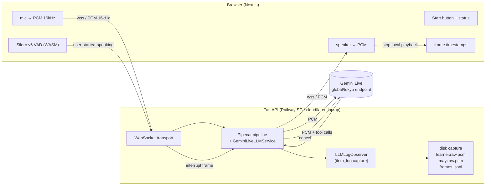

# Design — ABET-11 Week-one spike: voice pipeline prototype

## Context

The nine technical-design docs (`docs/technical-designs/01`-`09`) and 53 logged decisions define the real product. This spike touches only the voice hot path defined in `02-voice-pipeline.md` — it does not build the session engine, auth, payments, content pack, or LangGraph work. Everything the spike learns feeds back into either (a) closing the map, or (b) opening a follow-up ticket for a fallback design.

Prior research already resolved three technical questions before this spike started (see `research.md` for full findings + sources):

- **Client-side VAD:** `@ricky0123/vad-web` (Silero v6). Pipecat's own client SDK ships no browser-side VAD.
- **Wire format:** raw 16-bit PCM @ 16 kHz. Gemini Live only accepts PCM.
- **Pipecat barge-in bug (#3381):** already fixed by PR #3429 — spike must pin to a Pipecat release that includes that PR.

## Goals / Non-goals

**Goals**
- Measure four numbers under real Yangon mobile network conditions: item-log reliability, barge-in p95 latency, end-to-end p75 latency, Burmese-quality thumbs-up-or-down.
- Produce a clean pass/fail signal against PRD targets (item log ≥ 95% · barge-in ≤ 300ms p95 · end-to-end ≤ 1000ms p75 · Burmese thumbs-up).
- Throwaway code. Nothing here is a foundation for the production build.

**Non-goals**
- No production-quality error handling beyond "log and end cleanly".
- No production auth, payments, session-engine, R2 persistence.
- No production UI — one Start button + status line + Burmese "add to home screen" modal is the entire visible surface.

## Architecture



Reading rule: the browser is the source of truth for barge-in timing (client stops local playback + logs both events). The backend is the source of truth for item log and end-to-end audio arrival. `analyze.py` merges the two by session id.

## Data / contract changes

- **No production database.** Item log events go to `/tmp/{session_id}/frames.jsonl`. If we need durable log rows later, we point the Pipecat observer at Postgres instead — one line change.
- **JSONL schema** (one line per event):
  ```json
  {"ts_ms": 1234567890.12, "source": "client|backend|gemini", "event": "user_started_speaking|bot_started_speaking|item_log|error", "data": { ... }}
  ```
  Client events include a monotonic browser timestamp (`performance.now()`). Backend events use `time.monotonic_ns() // 1_000_000`. The two clocks are aligned post-hoc via a `ping` event exchanged on WebSocket open.

## Decisions

| # | Decision | Alternatives | Why |
|---|---|---|---|
| D1 | Ad-hoc conversational tutor for spike content | authored interview unit / scripted prompts | Founder is thinking a content-strategy pivot; committing to a specific pack is wasted work |
| D2 | Local disk + JSONL frame log | nothing / disk only | Two of four numbers are timing measurements; the JSONL is the only way to compute p50/p95 post-hoc |
| D3 | Cloudflared tunnel first, then Railway | Railway first / both parallel | Two independent measurement points; tunnel is faster to iterate; Railway-specific issues stay isolated |
| D4 | iOS Safari → Add-to-Home-Screen Burmese modal | push-to-talk / hard block | Preserves barge-in UX on iOS; keeps the product feeling like one product across platforms |
| D5 | All measurement in JSONL + `analyze.py` | live dashboard / console printf | No UI code in throwaway spike; JSONL + a tiny script is enough |
| D6 | Gemini failure → log-and-end cleanly | auto-retry / text fallback | Retry hides errors we want to see; text fallback is way over scope |
| D7 | Pin Pipecat to a release that contains PR #3429 | latest / arbitrary older | Barge-in bug fix is essential to hitting the 300ms target |
| D8 | Session id = UUID per WebSocket connect | user-provided nickname / no id | Anonymous, deterministic, no auth code needed |
| D9 | Clock sync via WebSocket ping event | NTP / trust device clocks | Trivial to implement; accurate to within one WebSocket round trip |

Full grilling decision log is in `proposal.md` (D1-D12 there map to the founder-facing questions asked during Step 2).

## Risks / trade-offs

- **Gemini serving region.** Latency budget assumes ≤ 20ms backend → Gemini same-region. Real answer is likely global-endpoint (US) or Tokyo — measured RTT will confirm. If p75 total > 1000ms even with tight VAD, we apply the fallback chain from `10 Gemini Live regional serving` decision (tighten VAD hangover → browser-direct → LiveKit APAC).
- **Silero v6 iOS OOM (VAD #134).** Confirmed still open. Modal is the fallback; no way to test WITHOUT it on old iPhones.
- **Ad-hoc content means we don't test the D-004 upgrade loop against a real pool.** Accepted — the upgrade loop is a prompt-engineering exercise that can happen against ad-hoc content just as well. The scenario "May offers ONE better phrase per turn" is testable without an authored pool.
- **Solo Burmese speaker vote for H4.** One data point is one data point. Accepted for the spike; cohort-1 will have multiple speakers.
- **Two clocks (browser + backend) with cross-clock timing.** WebSocket ping-based clock sync is accurate to within one RTT — fine for measurements at ms-precision but a systematic error of ~50ms is possible. Documented so we do not chase phantom bugs later.

## Rollout / rollback

- **No feature flag, no migration, no production surface.** The spike lives on a separate deploy (either `cloudflared` from laptop or a throwaway Railway service) and produces artefacts on disk plus a final `qa-report.md`.
- **Rollback = delete the spike branch and the Railway service.** Nothing depends on the spike code.
- **Success path:** all 4 numbers hit PRD targets → close map #5, open a "beta build" map for the production stack.
- **Partial-fail path:** item-log and barge-in pass, latency misses at Yangon → open a follow-up ticket per the fallback chain (`VAD tightening → browser-direct → LiveKit APAC`), close map #5 with recommendation.
- **Full-fail path:** two or more numbers miss badly → open an architecture-redesign ticket, keep map #5 open pending redesign.
